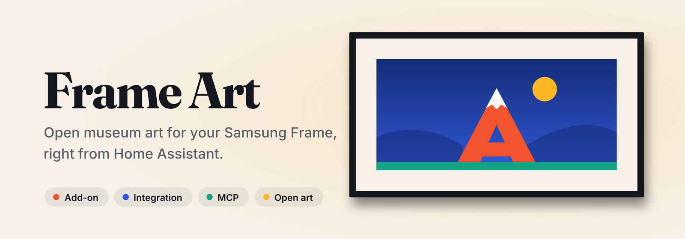
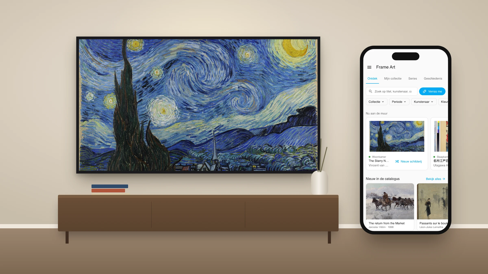
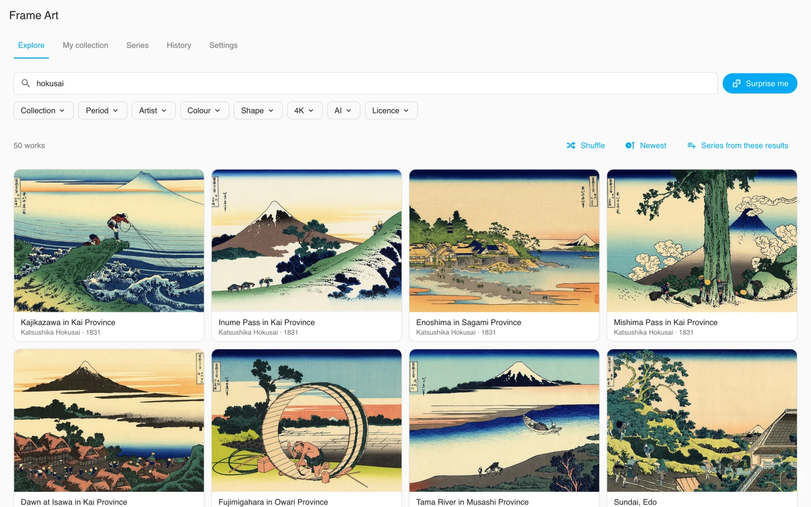
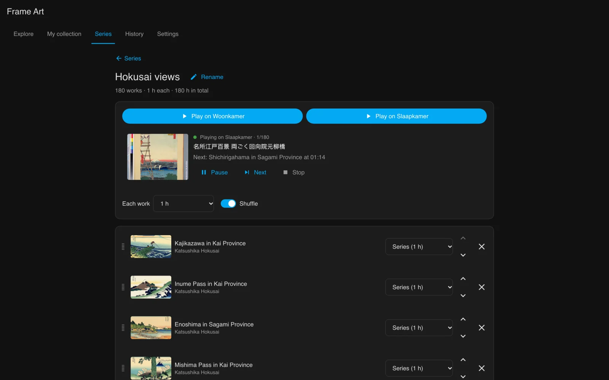
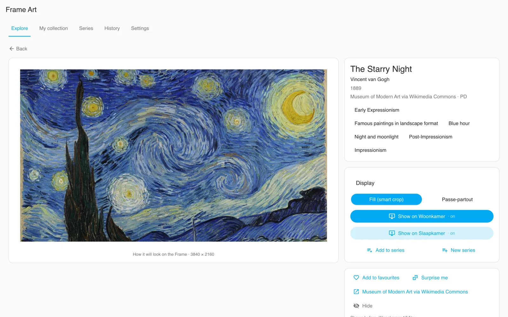
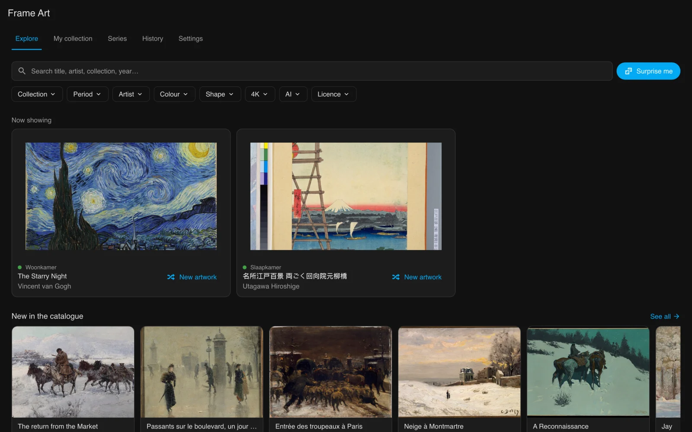
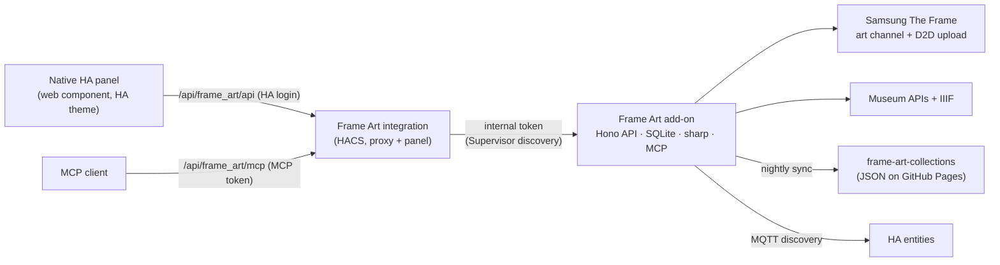

<p align="center">
  <picture>
    <source media="(prefers-color-scheme: dark)" srcset="docs/brand/png/banner-dark.png">
    
  </picture>
</p>

<p align="center">
  <a href="https://github.com/dstollie/ha-frame-art/blob/main/frame_art/CHANGELOG.md"></a>
  <a href="https://github.com/dstollie/ha-frame-art/actions/workflows/ci.yml"></a>
  <a href="https://github.com/dstollie/ha-frame-art/actions/workflows/validate.yml"></a>
  <a href="https://hacs.xyz/docs/faq/custom_repositories/"></a>
  <a href="https://www.home-assistant.io"></a>
  <a href="https://github.com/dstollie/frame-art-collections"></a>
  <a href="LICENSE"></a>
  <a href="https://github.com/dstollie/ha-frame-art/stargazers"></a>
</p>

<p align="center">
  <a href="https://my.home-assistant.io/redirect/supervisor_add_addon_repository/?repository_url=https%3A%2F%2Fgithub.com%2Fdstollie%2Fha-frame-art"></a>
  <a href="https://my.home-assistant.io/redirect/hacs_repository/?owner=dstollie&repository=ha-frame-art&category=integration"></a>
</p>

**Turn your Samsung The Frame into a gallery.** Frame Art browses thousands of public-domain paintings from museums worldwide, shows you exactly how a work will hang, and puts it on your Frame in Art Mode with one tap. It lives inside Home Assistant as a native panel, rotates series on a schedule, and lets an AI assistant do all of it over MCP.

<p align="center">
  
</p>

## Features

- 🖼️ **Explore** thousands of curated, openly licensed works. Search as you type (typo-tolerant, over title, artist, tags, collection and year) and filter on collection, period, artist, colour, shape, 4K, AI and licence. Every view is a shareable URL. **Surprise me** when you can't choose.
- 🏛️ **Live museum search:** not in the catalogue? Search The Met, the Art Institute of Chicago, the Rijksmuseum, Cleveland, SMK and Wikimedia Commons directly, and keep what you like.
- ✂️ **Looks right on the wall:** *Fill* uses an attention-based smart crop that keeps faces and the subject in view; *Passe-partout* (light, dark or blur) shows the whole work. The preview is the real 3840 × 2160 render.
- 📺 **One tap to the TV:** the add-on downloads the work, renders it, wakes the TV if needed, uploads it, switches Art Mode on, and cleans up its own old uploads so the TV doesn't fill up.
- 🔁 **Series:** playlists that rotate on one or more TVs, in order or shuffled, with a duration per series and per work.
- 📷 **My collection:** your own photos and art, in albums, shown the same way.
- 🏠 **Native in Home Assistant:** a sidebar panel with HA's own components, theme and language (English, Dutch), plus entities for every TV for your automations.
- 🤖 **MCP server:** Claude or another MCP client can search art, build series and put works on a TV.
- 🎨 **Community collections:** the catalogue is [frame-art-collections](https://github.com/dstollie/frame-art-collections), open JSON that anyone can add to.

| Search as you type | A series, playing on a TV |
|---|---|
|  |  |
| **A work, as it will hang** | **What's on each TV, in the dark theme** |
|  |  |

## Quick start

You need Home Assistant OS on a Raspberry Pi 4 or 5 (aarch64) and a Samsung The Frame from 2022 or later on the same network.

**1. Install the app (add-on).** Press the first button above, or go to **Settings → Apps → Install app → ⋮ → Repositories** and add `https://github.com/dstollie/ha-frame-art`. Install **Frame Art**, add your TVs on the **Configuration** tab and start it:

```yaml
tvs:
  - name: Living room
    host: 192.168.1.151
    wake_entity: media_player.frame_living_room   # optional: an entity that can switch it on (SamsungTV Smart)
```

**2. Install the integration.** Press the second button, or open **Settings → Marketplace** (Home Assistant 2026.11 and later; HACS before that) → ⋮ → **Custom repositories**, add `https://github.com/dstollie/ha-frame-art` as an *Integration* and install **Frame Art**. Restart Home Assistant. The running app announces itself: under **Settings → Devices & services**, press *Configure* on **Frame Art discovered**. **Frame Art** appears in the sidebar.

**3. Pair and hang.** Switch the TV on, stand next to it, open **Frame Art → Settings → Pair** and choose **Allow** on the TV. Then pick a work and press **Show**.

Optional: Mosquitto for HA entities, and [SamsungTV Smart](https://github.com/ollo69/ha-samsungtv-smart) to switch a TV on. Every option is in [frame_art/DOCS.md](frame_art/DOCS.md).

## How it works

Frame Art has two parts. The **app** (add-on) does the work: it holds the catalogue, renders images and talks to the TVs. The **integration** puts the native panel in HA's sidebar and makes the API and MCP reachable through Home Assistant, Nabu Casa included. Without the integration, the app's own page (**Open Web UI**) shows the same panel.



- **The Frame's art API:** the add-on speaks the Frame's art channel (`wss://<tv>:8002/api/v2/channels/com.samsung.art-app`) through its own TypeScript port of [samsungtvws](https://github.com/xchwarze/samsung-tv-ws-api): `send_image` → a one-off D2D socket for the JPEG → `select_image` → Art Mode on. Every upload is exactly 3840×2160 with `matte_id: none`; the passe-partout is drawn by the add-on, from the same geometry the preview uses. 2022 firmware doesn't always confirm `select_image` and Art Mode, so those confirmations are optional.
- **Series:** the add-on keeps the schedule (per TV, in SQLite, so it survives restarts) and each step is a normal job. A work still on the TV is only selected (`get_content_list` + `select_image`), so a looping series doesn't upload again. The TV's own slideshow can't play a subset with per-work durations; see [the ADR](knowledge/codebase/06-adr-series-playback.md).
- **Pairing:** the TV asks *"Allow FrameArt?"* the first time. Some Frames that already trust the client accept without a token; both count as paired. The add-on never opens the art channel to a TV that isn't paired, so it can't pop up prompts on its own.
- **Native panel:** the integration registers a custom panel (`embed_iframe: false`) whose module the add-on serves, so UI updates ship with add-on releases. The panel renders in a shadow root, maps all colours to HA's theme variables, and uses HA's own elements (`ha-card`, `ha-button`, `ha-switch`, `ha-alert`) with a styled fallback when HA hasn't loaded one. Why this route: [knowledge/codebase/05-adr-native-panel.md](knowledge/codebase/05-adr-native-panel.md).
- **Security:** the add-on accepts HA ingress (from the Supervisor's ingress proxy), the integration's internal token (handed over through Supervisor discovery), and on `/mcp` only the MCP token. Settings (including the MCP token) are admin-only in the panel. Tokens are never logged.

## Where the art comes from

**The catalogue is [frame-art-collections](https://github.com/dstollie/frame-art-collections):** curated collections of openly licensed works (Impressionism, the Dutch Golden Age, ukiyo-e, seasons, colour moods, Audubon, Haeckel, maps, AI-made works and more), published as JSON on GitHub Pages. The app syncs them every night and on **Settings → Refresh now**, stores each work once however many collections hold it, and you switch collections on or off under **Settings → Collections**. CC BY and CC BY-SA works show their credit line.

**Museums are live search.** When you search Explore, *Search the museums* asks these APIs directly. Results aren't stored: save one to **My collection**, or propose it for the collections (a pre-filled GitHub issue). A result the catalogue already has says so (same id at the museum, the same Wikimedia Commons file, or a look-alike thumbnail).

| Museum | On by default | Key |
|---|---|---|
| The Metropolitan Museum of Art | ✓ | — |
| Art Institute of Chicago | ✓ | — |
| Rijksmuseum | ✓ | — |
| Cleveland Museum of Art | ✓ | — |
| SMK – National Gallery of Denmark | ✓ | — |
| Wikimedia Commons (Google Art Project) | ✓ | — |
| Europeana | — | optional (public demo key otherwise) |
| Smithsonian American Art Museum | — | required (free api.data.gov key) |

**Share your own selection:** on a series or an album, *Share as collection* builds a `collection.v1` manifest (download the JSON) or opens the repository's issue form with the works filled in; a bot turns it into a pull request. Own uploads are never shared.

### Add a museum

A provider is one file in `frame_art/packages/server/src/providers/` that implements `ArtProvider` (`types.ts`): `search(q, { fetch, apiKey, limit })` returns open-access works with an image, and `downloadUrl(art)` says where a ≥3840 px rendition lives. Keep parsing in pure functions tested on a saved API response under `test/fixtures/`, and register it in `providers/registry.ts`.

## AI assistants (MCP)

The add-on is an MCP server (streamable HTTP). Tools:

| Tool | What it does |
|---|---|
| `search_art` | Search the catalogue: typo-tolerant text, collection, century, artist, colour, 4K, AI, or My collection |
| `list_sources` | Collections, live-search museums, categories and colours |
| `search_museums` | Live search in the museums; says which results the catalogue already has |
| `save_museum_work` | Keep a live result in My collection |
| `share_collection` | A series, album or works as a `collection.v1` manifest + pre-filled GitHub issue |
| `list_tvs` | TVs, on/paired, display mode, what they show |
| `get_current_art` | What a TV (or every TV) shows now |
| `show_artwork` | Put a work on a TV, with `display: "fill" \| "matte"` and `matte_style: light \| dark \| blur` |
| `upload_image` | Add an image from a URL or base64 to My collection (optionally into an album) and optionally show it right away |
| `list_albums` | Albums in My collection |
| `list_series`, `get_series` | Series with their works, durations and where they play |
| `create_series` | A series from artwork ids, an album and/or search results, with a duration per work and shuffle |
| `update_series` | Rename, durations (per series or per work), shuffle, add, remove, reorder |
| `delete_series` | Delete a series (stops it everywhere) |
| `play_series` | Play a series on one or more TVs |
| `control_playback` | Pause, resume, next or stop on a TV |

**Connect:** open Frame Art → **Settings → AI assistants (MCP)**. It shows the endpoint and the token (copy, show, or create a new one). The token controls your Frames; keep it secret.

- Through Home Assistant (local or Nabu Casa): `https://<your-ha>/api/frame_art/mcp`, for example `https://xxxx.ui.nabu.casa/api/frame_art/mcp`.
- **Claude Code:**
  ```sh
  claude mcp add --transport http frame-art https://<your-ha>/api/frame_art/mcp --header "Authorization: Bearer <token>"
  ```
- **Clients that can't set headers** (some custom connectors): put the token in the URL, `https://<your-ha>/api/frame_art/mcp?token=<token>`. Anyone with that URL controls the Frames, so treat it as a password.
- Any other MCP client: streamable HTTP, `Authorization: Bearer <token>`.

Then ask, for example: *"Put a calm seascape on the living room TV, with a dark passe-partout"* or *"Upload this photo to the album Holidays and show it in the bedroom"*.

## 🎨 Add your collection

<p align="center">
  <a href="https://github.com/dstollie/frame-art-collections/issues/new?template=new-collection.yml"></a>
  &nbsp;
  <a href="https://dstollie.github.io/frame-art-collections/"></a>
</p>

Every Frame Art user gets the community collections. Got a theme you'd leave on your wall for a week? Share it:

- **Fill in a form:** [open a "New collection" issue](https://github.com/dstollie/frame-art-collections/issues/new?template=new-collection.yml), paste links to works on Wikimedia Commons, Wikidata, SMK or The Met, and a bot opens the pull request for you.
- **Ask an AI agent:** clone [frame-art-collections](https://github.com/dstollie/frame-art-collections) and ask Claude Code or Codex to *"add a collection of misty landscapes"*. The repo ships an [`add-collection` skill](https://github.com/dstollie/frame-art-collections/tree/main/.agents/skills/add-collection) that finds openly licensed 4K works and opens the PR.
- **From the panel:** on a series or album, **Share as collection** pre-fills the form with your works.

Looking for a place to start? See the [good first collection](https://github.com/dstollie/frame-art-collections/labels/good%20first%20collection) issues.

## FAQ

<details>
<summary><b>Which TVs work?</b></summary>

Samsung The Frame from 2022 onwards (LS03B and later), on the same network as Home Assistant. Older Frames use a different art protocol. Other Samsung TVs have no Art Mode.
</details>

<details>
<summary><b>Do I need both the app and the integration?</b></summary>

The app is required: it talks to the TVs. The integration is optional but recommended: it gives you the sidebar panel and MCP through Home Assistant (and Nabu Casa). Without it, use the app's **Open Web UI**.
</details>

<details>
<summary><b>Does it run on x86 or a Home Assistant Green / Yellow?</b></summary>

Green and Yellow are aarch64, so yes. x86-64 (amd64) isn't built yet; follow the issues if you need it.
</details>

<details>
<summary><b>Is the art really free to use?</b></summary>

Yes. Every work in the catalogue is public domain, CC0, CC BY or CC BY-SA, and the licence and source are stored with it. CC BY works show their credit line in the panel. Nothing is copied to a server of ours: images come straight from the museums and Wikimedia Commons.
</details>

<details>
<summary><b>Will it fill up my TV?</b></summary>

No. The app keeps only its own newest uploads (`keep_uploads`, more for favourites) and removes the rest. Your own Art Store and photos are left alone.
</details>

<details>
<summary><b>What does it send to the internet?</b></summary>

It downloads images and metadata from the museums, Wikimedia Commons and the collections index on GitHub Pages. TV control stays on your network. There is no account, no telemetry and no cloud of ours.
</details>

<details>
<summary><b>Is this made by Samsung or Home Assistant?</b></summary>

No. Frame Art is an independent community project. Samsung and The Frame are trademarks of Samsung Electronics; Home Assistant is a project of the Open Home Foundation.
</details>

## Development

```sh
cd frame_art
pnpm install
pnpm dev:stack   # API + built panel + two fake Frames + a fake collections repo and museum
                 # → http://localhost:8123/frame-art/ (as an HA panel; ?theme=dark, ?lang=nl)
                 # → http://localhost:8123/api/hassio_ingress/dev-token-123/ (as the ingress page)
```

| Path | |
|---|---|
| `frame_art/packages/frame-tv` | Art-channel client + `FakeFrame` (a fake TV speaking the same protocol) |
| `frame_art/packages/server` | Hono API (typed RPC), providers, catalogue (drizzle + better-sqlite3), sharp render, jobs, MCP, MQTT |
| `frame_art/packages/web` | The panel: React 19 web component, TanStack Router/Query/Virtual, Tailwind on HA theme variables |
| `custom_components/frame_art` | The HA integration (Python): config flow, proxy views, panel registration |

Agent instructions: [AGENTS.md](AGENTS.md). Architecture, flows and guidelines: [knowledge/](knowledge/codebase/01-index.md).

## Tests and checks

```sh
cd frame_art
pnpm lint && pnpm format:check && pnpm typecheck
pnpm test        # protocol tests (FakeFrame) + server unit, integration and MCP tests
pnpm test:e2e    # Playwright: the panel in a fake HA page (light/dark, en/nl, desktop/phone) and the ingress page
pnpm check       # all of the above
pnpm docker:build
cd .. && uv run ruff check && uv run pytest   # the integration, against a real HA test instance
```

The end-to-end tests run the real API, the real TV client, the real sharp pipeline and a real MCP client against fake Frames, a fake museum and a fake HA. They check, for example, that a TV receives a 3840×2160 JPEG with the right crop or passe-partout, that a 2022 Frame that doesn't confirm still finishes the job, and that only the newest uploads stay on the TV.

## Release flow

1. Bump `version` in `frame_art/config.yaml` and `custom_components/frame_art/manifest.json`, and add a `frame_art/CHANGELOG.md` entry.
2. Commit `chore(release): x.y.z` and push to `main`.
3. CI runs every check (TypeScript and Python) and builds the image on a native arm64 runner. The first time a version appears it publishes `ghcr.io/dstollie/frame-art-aarch64:x.y.z` and `:latest`; published versions are never overwritten. Every push also gets `:edge` and `:sha-<commit>`.
4. Home Assistant shows the add-on update; HACS shows the integration update (it tracks the default branch).

## Credits and licences

- **Code:** [MIT](LICENSE). **Brand:** [docs/brand](docs/brand/README.md); the fonts (Fraunces, Inter) are under the SIL Open Font Licence.
- **Collections:** the manifests in [frame-art-collections](https://github.com/dstollie/frame-art-collections) are CC0. Each image keeps its own licence, stated on the item.
- **Museum data and images:** [The Metropolitan Museum of Art](https://www.metmuseum.org/about-the-met/policies-and-documents/open-access) (Open Access, CC0), [Art Institute of Chicago](https://www.artic.edu/open-access/open-access-images) (CC0 public-domain images), [Rijksmuseum](https://www.rijksmuseum.nl/en/research/conduct-research/data) (CC0 / public domain), [Cleveland Museum of Art](https://www.clevelandart.org/open-access) (CC0), [SMK – National Gallery of Denmark](https://open.smk.dk) (public domain), [Wikimedia Commons](https://commons.wikimedia.org) and [Wikidata](https://www.wikidata.org) (per-file licence; Wikidata is CC0), [Europeana](https://www.europeana.eu) (per-item rights) and the [Smithsonian](https://www.si.edu/openaccess) (Open Access, CC0). Thank you for opening your collections.
- **Protocol:** the art-channel client follows the work of the [samsungtvws](https://github.com/xchwarze/samsung-tv-ws-api) contributors.
- **Screenshots:** *The Starry Night* (Van Gogh, 1889, MoMA) and Hokusai's *Thirty-six Views of Mount Fuji* are public domain.
