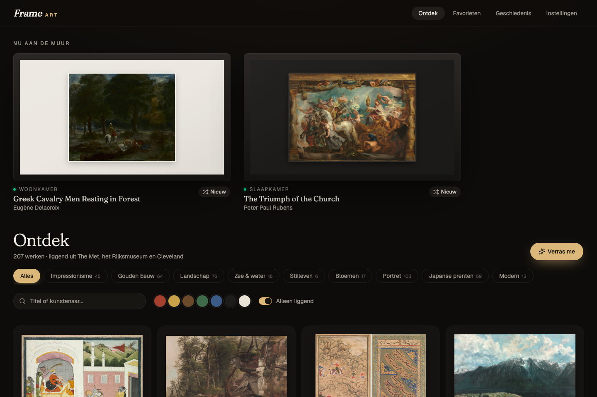
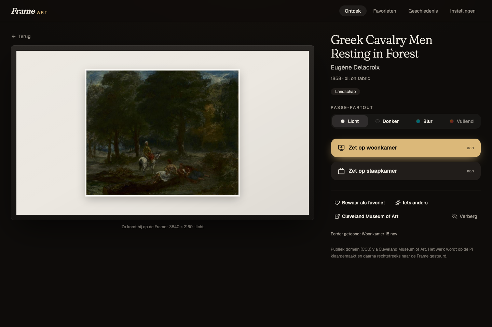
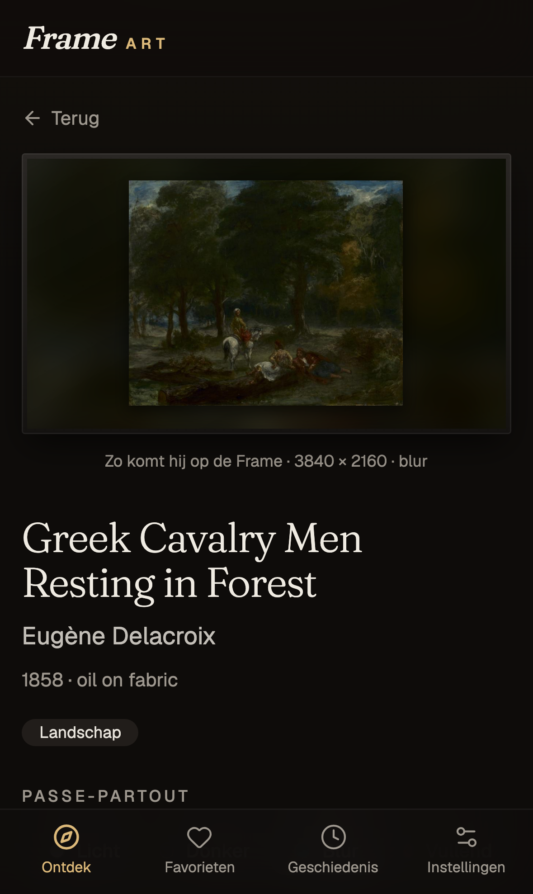
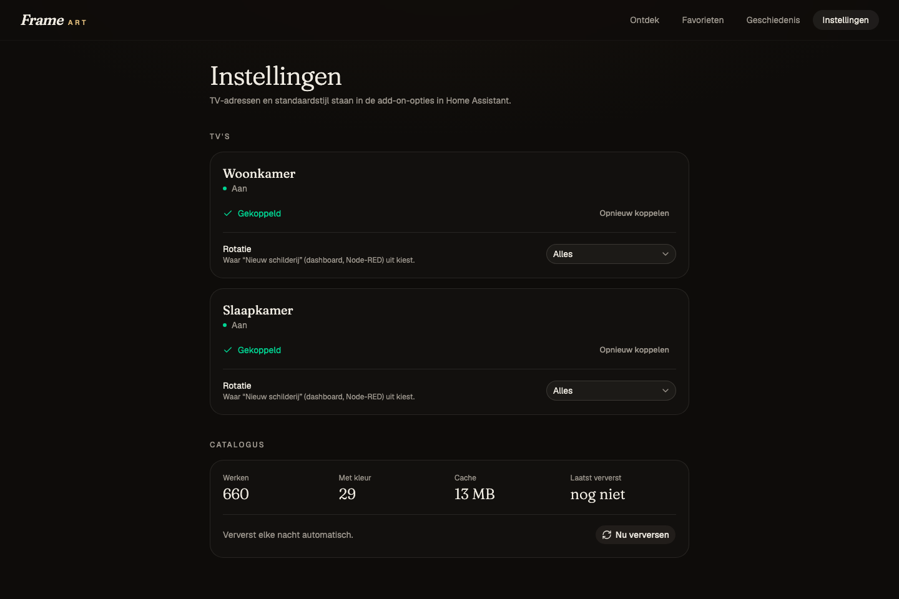
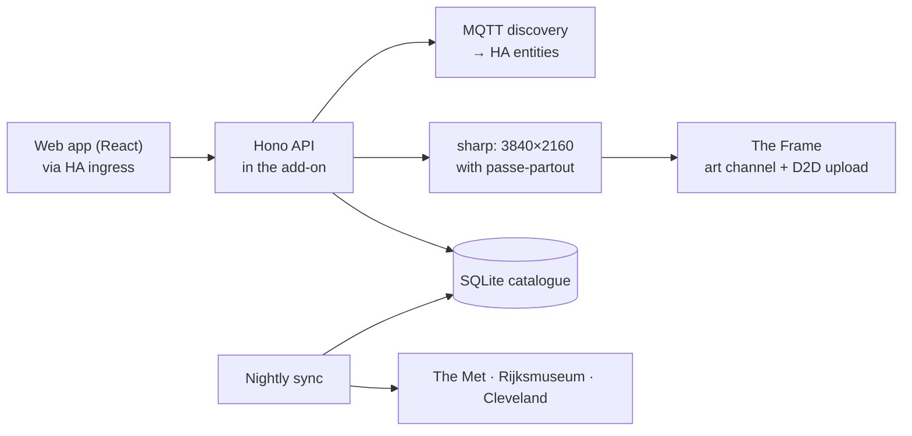

# Frame Art

**Museum paintings on your Samsung The Frame, with one tap.** A Home Assistant add-on that lets you browse open-access paintings from The Met, the Rijksmuseum and the Cleveland Museum of Art, see exactly how a work will look on the wall, and send it to a Frame in Art Mode.



| A work, previewed exactly as it will hang | On the phone | Pairing and rotation |
|---|---|---|
|  |  |  |

## What it does

- **Browse** about 15–25 thousand public-domain paintings by category (Impressionisme, Gouden Eeuw, Landschap, Zee & water, Stilleven, Bloemen, Portret, Japanse prenten, Modern), by colour, or by search. **Verras me** picks one at random.
- **Preview** a work in a true-to-life Frame with a light, dark or blurred passe-partout, or full screen when the work is close to 16:9.
- **One tap** to send it to a TV: the add-on downloads the work, renders an exact 3840×2160 JPEG, switches the TV on if needed, uploads it, shows it and switches Art Mode on. Old uploads are cleaned up so the TV doesn't fill up.
- **Favourites, history and rotation.** Each TV gets HA entities, so Node-RED or an automation can hang a new painting every morning.

The UI is in Dutch.

## Install in Home Assistant

1. **Settings → Add-ons → Add-on Store → ⋮ → Repositories** and add `https://github.com/dstollie/ha-frame-art`.
2. Install **Frame Art**. The image (`ghcr.io/dstollie/frame-art-aarch64`) is prebuilt, so nothing compiles on the Pi.
3. Under **Configuration**, list your TVs:
   ```yaml
   tvs:
     - name: Woonkamer
       host: 192.168.1.151
       wake_entity: media_player.frame_woonkamer   # optional: SamsungTV Smart entity that can switch it on
     - name: Slaapkamer
       host: 192.168.1.152
   ```
4. Start the add-on and open **Frame Art** in the sidebar. The first catalogue sync runs in the background (about 40 minutes); works appear as they come in.
5. **Pair each TV once:** switch it on, stand next to it, open **Instellingen → Koppelen**, and choose **Toestaan** on the TV.

Requirements: aarch64 (Raspberry Pi 4/5), a Samsung The Frame from 2022 or later on the same network, and optionally the Mosquitto add-on for HA entities and SamsungTV Smart for waking the TV. All options are described in [frame_art/DOCS.md](frame_art/DOCS.md).

## How it works



### Museum APIs

All three sources are **CC0 and need no API key**:

- **The Met:** Collection API `v1.1/search` (paged; the old `v1/search` was retired in October 2026), then one object per ID. Original JPEGs of 3000–6000 px.
- **Rijksmuseum:** the new Linked Art Search and resolver, with images through IIIF on `iiif.micr.io`, requested at a size the Pi can handle.
- **Cleveland Museum of Art:** Open Access API with images and sizes inline.

None of them has a usable style or colour field, so the sync builds its own catalogue: categories from nationality, period, department and title words, a dominant colour from the thumbnail, and the aspect ratio. Sources that were considered and rejected (Art Institute of Chicago, Europeana, Wikimedia) are in [knowledge/external/museum-apis/sources.md](knowledge/external/museum-apis/sources.md).

### The Frame's art API

The Frame has an art channel (`wss://<tv>:8002/api/v2/channels/com.samsung.art-app`). Frame Art talks to it through its own TypeScript port of [samsungtvws](https://github.com/xchwarze/samsung-tv-ws-api), in `packages/frame-tv`:

1. `send_image` → the TV answers `ready_to_use` with a one-off socket address and key.
2. The JPEG goes over that **D2D socket** (TCP, or TLS on some firmware) → `image_added` with a content ID.
3. `select_image` and `set_artmode_status: on` → the work is on the wall.
4. `delete_image_list` removes its own older uploads.

Every upload is exactly 3840×2160 with `matte_id: none`: on 2022+ firmware that's the only way to get the same full-screen look on every model. The passe-partout is drawn by the add-on, from the same geometry the web preview uses.

### Pairing

The TV asks **"Allow FrameArt?"** the first time the add-on connects. That token is separate from Home Assistant's own Samsung integration, and is stored in the add-on's `/data/tokens`. Frame Art **never connects to a TV that hasn't been paired**, so it can't pop up prompts by itself. It checks whether a TV is on through REST on port 8001, not through the art channel.

### Home Assistant entities

With MQTT, each TV gets a device **Frame Art <name>** with `button.frame_art_<tv>_nieuw` (a new painting from the rotation), `select.frame_art_<tv>_rotatie`, `sensor.frame_art_<tv>_schilderij` (title plus attributes) and `image.frame_art_<tv>_schilderij` (what's hanging now).

## Development

```sh
cd frame_art
pnpm install
pnpm dev:stack     # API + built web app + two fake Frames + ~660 real works
                   # → http://localhost:8123/api/hassio_ingress/dev-token-123/
pnpm --filter web dev   # Vite dev server for UI work (proxies /api to :8099)
```

Monorepo (pnpm workspace in `frame_art/`):

| Package | |
|---|---|
| `packages/frame-tv` | Art-channel client + `FakeFrame`, a fake TV speaking the same protocol |
| `packages/server` | Hono API with a typed RPC contract, drizzle + better-sqlite3, sharp, jobs, sync, MQTT |
| `packages/web` | React 19 + Vite, TanStack Router (hash) / Query / Virtual, shadcn/ui, Tailwind 4 |

Architecture, flows and guidelines are in [knowledge/](knowledge/codebase/01-index.md); agent instructions are in [AGENTS.md](AGENTS.md).

## Tests and checks

```sh
pnpm lint            # oxlint, warnings are errors
pnpm format:check    # oxfmt
pnpm typecheck
pnpm test            # protocol tests against FakeFrame + server unit and end-to-end tests
pnpm test:e2e        # Playwright (desktop + phone) behind a fake ingress prefix
pnpm check           # all of the above, the same as CI
pnpm docker:build    # the aarch64 image, built the way the Supervisor would
```

The server's end-to-end tests run the real API through its typed client, the real TV client, and the real sharp pipeline against a fake Frame, a fake museum and a fake Home Assistant. They check, for example, that the TV receives a 3840×2160 JPEG under 4 MB, selects it and switches Art Mode on, and that only the newest uploads stay on the TV.

## Release flow

1. Bump `version` in [`frame_art/config.yaml`](frame_art/config.yaml) and add a line to [`frame_art/CHANGELOG.md`](frame_art/CHANGELOG.md).
2. Commit `chore(release): x.y.z` and push to `main`.
3. CI runs every check and builds the image on a native arm64 runner. The first time a version appears, it publishes `ghcr.io/dstollie/frame-art-aarch64:x.y.z` and `:latest`; published versions are never overwritten. Every push also gets `:edge` and `:sha-<commit>`.
4. Optionally tag `vx.y.z`; CI then checks that the tag matches `config.yaml`.
5. Home Assistant shows the update under Settings → Add-ons.

## Credits

Images and data © their museums, released under CC0. The art-channel protocol follows the work of the samsungtvws contributors.
