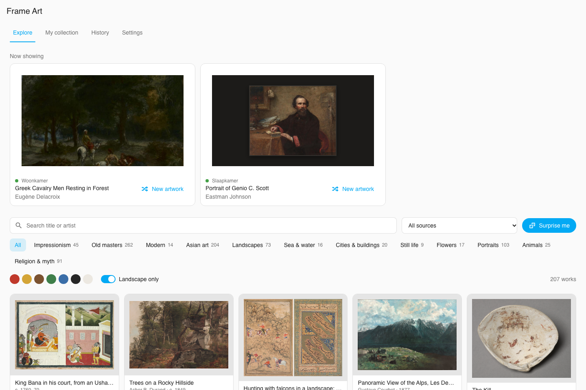
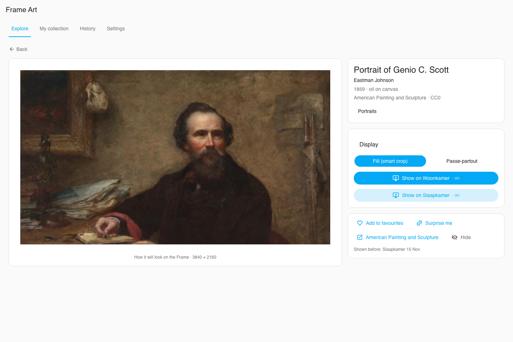
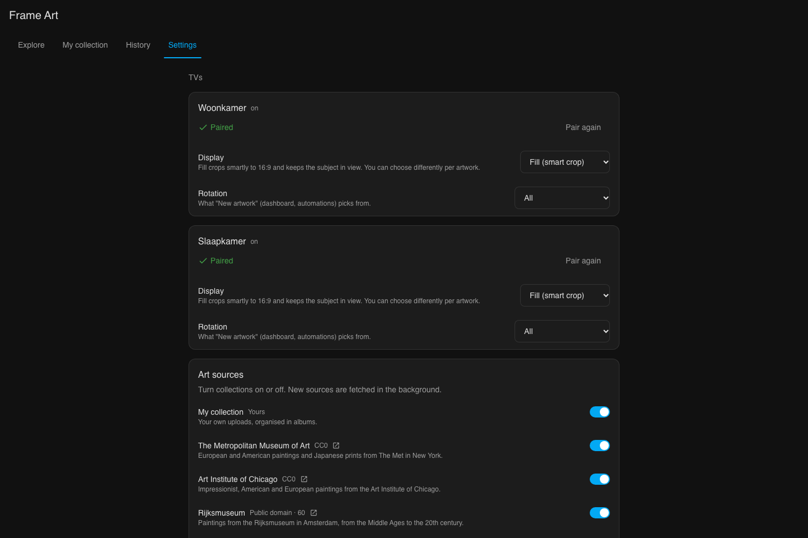
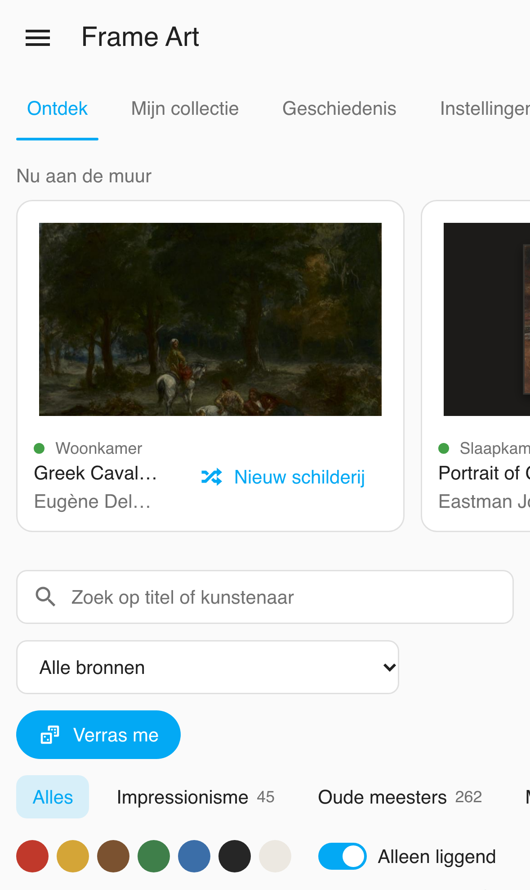
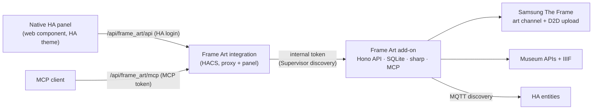

# Frame Art

**Open-access museum art, and your own photos, on a Samsung The Frame.** A Home Assistant add-on with a native panel: browse public-domain paintings from museums worldwide, see exactly how a work will look on the wall, and put it on a Frame in Art Mode with one tap. An AI assistant can do the same over MCP.



| A work, previewed as it will hang (smart crop) | Follows HA's theme and language | On the phone |
|---|---|---|
|  |  |  |

## What it does

- **Explore** thousands of curated, openly licensed works: search as you type (typo-tolerant, over title, artist, tags, collection and year), filter with facets (collection, period, artist, colour, shape, 4K, AI, licence), every view a shareable URL. Quick actions on each card (show on a TV, add to a series, new series), arrow keys to move around, **Surprise me** and shuffle. Not in the catalogue? Search the museums live.
- **Display mode per TV:** *Fill (smart crop)* fills the screen and keeps faces and the subject in view, using an attention-based crop. *Passe-partout* (light, dark or blur) shows the whole work. On any work you can choose differently for that one time; the preview shows the real crop.
- **One tap** to put it on a TV: the add-on downloads the work, renders an exact 3840×2160 JPEG, switches the TV on if needed, uploads it, shows it and switches Art Mode on. Its own old uploads are cleaned up, so the TV doesn't fill up.
- **My collection:** upload your own photos or art (files or a URL), organise them in albums, and show them the same way.
- **Native in Home Assistant:** a sidebar panel that uses HA's own components, theme (light and dark) and language (English, Dutch). Rotation, favourites and history are built in, and every TV gets HA entities for automations.
- **Series:** playlists that rotate on one or more TVs, in order or shuffled, with a duration per series and per work. Play, pause, next and stop from the panel, HA entities or MCP.
- **MCP server:** Claude or another MCP client can search art, upload images, build series and push them to a TV.

## Install

Frame Art has two parts that work together: the **add-on** (does the work, talks to the TVs) and the **integration** (puts the native panel in HA's sidebar, and makes the API and MCP reachable through Home Assistant, Nabu Casa included).

1. **Add-on:** Settings → Add-ons → Add-on Store → ⋮ → Repositories → add `https://github.com/dstollie/ha-frame-art`. Install **Frame Art**; the image (`ghcr.io/dstollie/frame-art-aarch64`) is prebuilt.
2. **Configure** the TVs on the add-on's Configuration tab and start it:
   ```yaml
   tvs:
     - name: Woonkamer
       host: 192.168.1.151
       wake_entity: media_player.frame_woonkamer   # optional: an entity that can switch it on (SamsungTV Smart)
     - name: Slaapkamer
       host: 192.168.1.152
   ```
3. **Integration:** HACS → ⋮ → Custom repositories → `https://github.com/dstollie/ha-frame-art`, type *Integration* → download **Frame Art** → restart Home Assistant. The running add-on announces itself, so Settings → Devices & services shows **Frame Art discovered**: press *Configure*. **Frame Art** appears in the sidebar.
4. **Pair each TV once:** switch it on, stand next to it, open Frame Art → **Settings → Pair**, and choose **Allow** on the TV.

Without the integration, the add-on's own ingress page shows the same UI (Open Web UI), without the sidebar entry or MCP through HA.

Requirements: Home Assistant OS on aarch64 (Raspberry Pi 4/5), a Samsung The Frame from 2022 or later on the same network. Optional: Mosquitto (for HA entities) and SamsungTV Smart (to switch a TV on). All add-on options are in [frame_art/DOCS.md](frame_art/DOCS.md).

## Where the art comes from

**The catalogue is [frame-art-collections](https://github.com/dstollie/frame-art-collections):** curated collections of openly licensed works (Impressionism, Dutch Golden Age, ukiyo-e, seasons, colour moods, Audubon, Haeckel, maps, AI-made works, …), published as JSON on GitHub Pages. The add-on syncs them every night (and on **Settings → Refresh now**), stores each work once however many collections hold it, and you switch collections on or off under **Settings → Collections**. CC BY and CC BY-SA works show their credit line.

**Museums are live search.** When you search Explore, *Search the museums* asks these APIs directly. Results aren't stored: save one to **My collection**, or propose it for the collections (a pre-filled GitHub issue). A result the catalogue already has says so (same id at the museum, the same Wikimedia Commons file, or a look-alike thumbnail).

| Museum | On by default | Key |
|---|---|---|
| The Metropolitan Museum of Art | ✓ | — |
| Art Institute of Chicago | ✓ | — |
| Rijksmuseum | ✓ | — |
| Cleveland Museum of Art | ✓ | — |
| SMK – National Gallery of Denmark | ✓ | — |
| Wikimedia Commons (Google Art Project) | ✓ | — |
| Europeana | — | optional (public demo key otherwise) |
| Smithsonian American Art Museum | — | required (free api.data.gov key) |

**Share your own selection:** on a series or an album, *Share as collection* builds a `collection.v1` manifest (download the JSON) or opens the repository's issue form with the works filled in; a bot turns it into a pull request. Own uploads are never shared.

### Adding a museum

A provider is one file in `frame_art/packages/server/src/providers/` that implements `ArtProvider` (`types.ts`): `search(q, { fetch, apiKey, limit })` returns open-access works with an image, and `downloadUrl(art)` says where a ≥3840 px rendition lives. Keep parsing in pure functions tested on a saved API response under `test/fixtures/`, and register it in `providers/registry.ts`.

## AI assistants (MCP)

The add-on is an MCP server (streamable HTTP). Tools:

| Tool | What it does |
|---|---|
| `search_art` | Search the catalogue: typo-tolerant text, collection, century, artist, colour, 4K, AI, or My collection |
| `list_sources` | Collections, live-search museums, categories and colours |
| `search_museums` | Live search in the museums; says which results the catalogue already has |
| `save_museum_work` | Keep a live result in My collection |
| `share_collection` | A series, album or works as a `collection.v1` manifest + pre-filled GitHub issue |
| `list_tvs` | TVs, on/paired, display mode, what they show |
| `get_current_art` | What a TV (or every TV) shows now |
| `show_artwork` | Put a work on a TV, with `display: "fill" \| "matte"` and `matte_style: light \| dark \| blur` |
| `upload_image` | Add an image from a URL or base64 to My collection (optionally into an album) and optionally show it right away |
| `list_albums` | Albums in My collection |
| `list_series`, `get_series` | Series with their works, durations and where they play |
| `create_series` | A series from artwork ids, an album and/or search results, with a duration per work and shuffle |
| `update_series` | Rename, durations (per series or per work), shuffle, add, remove, reorder |
| `delete_series` | Delete a series (stops it everywhere) |
| `play_series` | Play a series on one or more TVs |
| `control_playback` | Pause, resume, next or stop on a TV |

**Connect:** open Frame Art → **Settings → AI assistants (MCP)**. It shows the endpoint and the token (copy, show, or create a new one). The token controls your Frames; keep it secret.

- Through Home Assistant (local or Nabu Casa): `https://<your-ha>/api/frame_art/mcp`, for example `https://xxxx.ui.nabu.casa/api/frame_art/mcp`.
- **Claude Code:**
  ```sh
  claude mcp add --transport http frame-art https://<your-ha>/api/frame_art/mcp --header "Authorization: Bearer <token>"
  ```
- **Clients that can't set headers** (some custom connectors): put the token in the URL, `https://<your-ha>/api/frame_art/mcp?token=<token>`. Anyone with that URL controls the Frames, so treat it as a password.
- Any other MCP client: streamable HTTP, `Authorization: Bearer <token>`.

Then ask, for example: *"Put a calm seascape on the living room TV, with a dark passe-partout"* or *"Upload this photo to the album Holidays and show it in the bedroom"*.

## How it works



- **The Frame's art API:** the add-on speaks the Frame's art channel (`wss://<tv>:8002/api/v2/channels/com.samsung.art-app`) through its own TypeScript port of [samsungtvws](https://github.com/xchwarze/samsung-tv-ws-api): `send_image` → a one-off D2D socket for the JPEG → `select_image` → Art Mode on. Every upload is exactly 3840×2160 with `matte_id: none`; the passe-partout is drawn by the add-on, from the same geometry the preview uses. 2022 firmware doesn't always confirm `select_image` and Art Mode, so those confirmations are optional.
- **Series:** the add-on keeps the schedule (per TV, in SQLite, so it survives restarts) and each step is a normal job. A work still on the TV is only selected (`get_content_list` + `select_image`), so a looping series doesn't upload again. The TV's own slideshow can't play a subset with per-work durations; see [the ADR](knowledge/codebase/06-adr-series-playback.md).
- **Pairing:** the TV asks *"Allow FrameArt?"* the first time. Some Frames that already trust the client accept without a token; both count as paired. The add-on never opens the art channel to a TV that isn't paired, so it can't pop up prompts on its own.
- **Native panel:** the integration registers a custom panel (`embed_iframe: false`) whose module the add-on serves, so UI updates ship with add-on releases. The panel renders in a shadow root, maps all colours to HA's theme variables, and uses HA's own elements (`ha-card`, `ha-button`, `ha-switch`, `ha-alert`) with a styled fallback when HA hasn't loaded one. Why this route: [knowledge/codebase/05-adr-native-panel.md](knowledge/codebase/05-adr-native-panel.md).
- **Security:** the add-on accepts HA ingress (from the Supervisor's ingress proxy), the integration's internal token (handed over through Supervisor discovery), and on `/mcp` only the MCP token. Settings (including the MCP token) are admin-only in the panel. Tokens are never logged.

## Development

```sh
cd frame_art
pnpm install
pnpm dev:stack   # API + built panel + two fake Frames + a fake collections repo and museum
                 # → http://localhost:8123/frame-art/ (as an HA panel; ?theme=dark, ?lang=nl)
                 # → http://localhost:8123/api/hassio_ingress/dev-token-123/ (as the ingress page)
```

| Path | |
|---|---|
| `frame_art/packages/frame-tv` | Art-channel client + `FakeFrame` (a fake TV speaking the same protocol) |
| `frame_art/packages/server` | Hono API (typed RPC), providers, catalogue (drizzle + better-sqlite3), sharp render, jobs, MCP, MQTT |
| `frame_art/packages/web` | The panel: React 19 web component, TanStack Router/Query/Virtual, Tailwind on HA theme variables |
| `custom_components/frame_art` | The HA integration (Python): config flow, proxy views, panel registration |

Agent instructions: [AGENTS.md](AGENTS.md). Architecture, flows and guidelines: [knowledge/](knowledge/codebase/01-index.md).

## Tests and checks

```sh
cd frame_art
pnpm lint && pnpm format:check && pnpm typecheck
pnpm test        # protocol tests (FakeFrame) + server unit, integration and MCP tests
pnpm test:e2e    # Playwright: the panel in a fake HA page (light/dark, en/nl, desktop/phone) and the ingress page
pnpm check       # all of the above
pnpm docker:build
cd .. && uv run ruff check && uv run pytest   # the integration, against a real HA test instance
```

The end-to-end tests run the real API, the real TV client, the real sharp pipeline and a real MCP client against fake Frames, a fake museum and a fake HA. They check, for example, that a TV receives a 3840×2160 JPEG with the right crop or passe-partout, that a 2022 Frame that doesn't confirm still finishes the job, and that only the newest uploads stay on the TV.

## Release flow

1. Bump `version` in `frame_art/config.yaml` and `custom_components/frame_art/manifest.json`, and add a `frame_art/CHANGELOG.md` entry.
2. Commit `chore(release): x.y.z` and push to `main`.
3. CI runs every check (TypeScript and Python) and builds the image on a native arm64 runner. The first time a version appears it publishes `ghcr.io/dstollie/frame-art-aarch64:x.y.z` and `:latest`; published versions are never overwritten. Every push also gets `:edge` and `:sha-<commit>`.
4. Home Assistant shows the add-on update; HACS shows the integration update (it tracks the default branch).

## Credits

Images and data © their museums and Wikimedia contributors, released under CC0 or as public domain. The art-channel protocol follows the work of the samsungtvws contributors.
