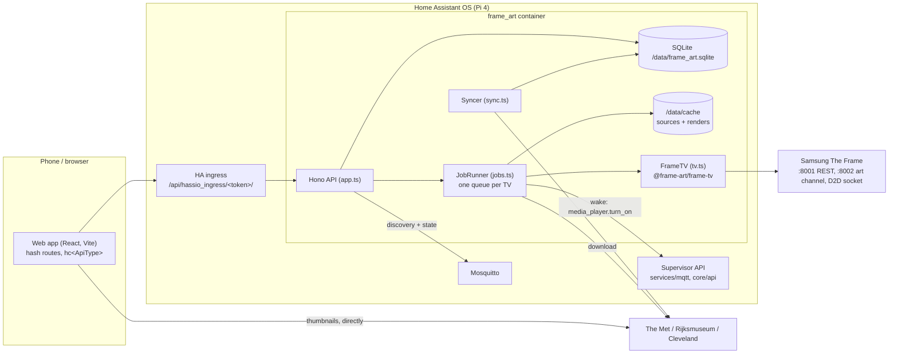

# Architecture

## Overview

Since 0.2.0 there are two parts: the **add-on** (this Node process: API, catalogue, rendering, TV I/O, MCP) and the **integration** (`custom_components/frame_art`, Python) that registers a native sidebar panel and proxies `/api/frame_art/api/*`, `/api/frame_art/mcp` and `/api/frame_art/panel.js` to the add-on with an internal token from Supervisor discovery. See @knowledge/codebase/05-adr-native-panel.md. The diagram below shows the add-on itself.

Frame Art is one Node process inside a Home Assistant add-on container. It serves a Hono API under `/api` and the built web app as static files. Home Assistant reaches it through **ingress** (sidebar panel, also over Nabu Casa); nothing else is exposed.

## Packages

| Package | Responsibility | Depends on |
|---|---|---|
| `@frame-art/frame-tv` | The art-channel protocol (connect, token, requests, D2D upload) and a `FakeFrame` that speaks it. No app logic. | `ws` |
| `@frame-art/server` | Hono app, catalogue sources, categories, SQLite, render, jobs, sync, MQTT, Supervisor calls. Exports types only to the web app (`./api`, `./geometry`, `./models`). | frame-tv, sharp, better-sqlite3, drizzle, mqtt |
| `web` | The panel: a `<frame-art-panel>` web component (React in a shadow root) built as one ES module. Only talks to the API through `hc<ApiType>`. | server (types + geometry only) |
| `custom_components/frame_art` | HA integration: config flow (Supervisor discovery), proxy views, panel registration. | Home Assistant |

## Decisions that shape the code

- **TypeScript port instead of a Python sidecar.** `samsungtvws` is Python-only, but the part we need is about 250 lines. One runtime, one process, and the protocol can be tested against `FakeFrame`. Only the 2022+ D2D-socket upload is implemented, not the 0.97 binary-frame path.
- **Catalogue instead of live search.** The museum APIs have no usable style or colour fields, and two of them need one request per work. A nightly sync builds a local SQLite catalogue with our own categories, a dominant colour and an aspect ratio.
- **Shared geometry.** `geometry.ts` has no Node imports, so the web app imports it as source. The CSS preview and the sharp render therefore always agree.
- **Ingress-safe frontend.** Vite `base: "./"`, TanStack Router with hash history, and the API client built from `document.baseURI`. The ingress prefix is dynamic, so nothing may be absolute.
- **Prebuilt image.** `config.yaml` has `image: ghcr.io/dstollie/frame-art-{arch}`. The Supervisor pulls the image matching `version`; CI builds it on a native arm64 runner.
- **Thumbnails load straight from the museums.** That keeps the Pi out of the browse path; the Pi only downloads full sources when a work is actually sent to a TV.

## Runtime layout (`/data`)

| Path | What |
|---|---|
| `options.json` | Add-on options, written by the Supervisor, validated by zod in `config.ts` |
| `frame_art.sqlite` | Catalogue, favourites, uploads, history, source settings, albums, meta (tokens, display modes, rotation) |
| `collection/` | My collection: `<uuid>.jpg` (≤ 6000 px) and `<uuid>_thumb.jpg`; never pruned |
| `tokens/<tv>.token` | Art-channel token per TV (mode 600) |
| `cache/sources`, `cache/renders`, `cache/thumbs` | LRU disk cache, capped by `cache_mb` |
