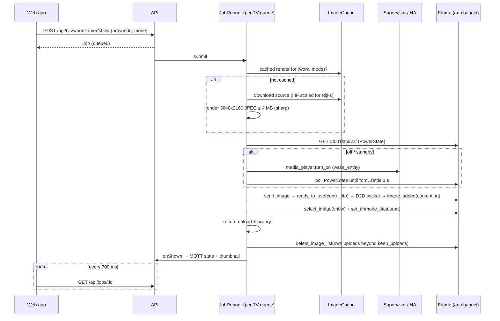
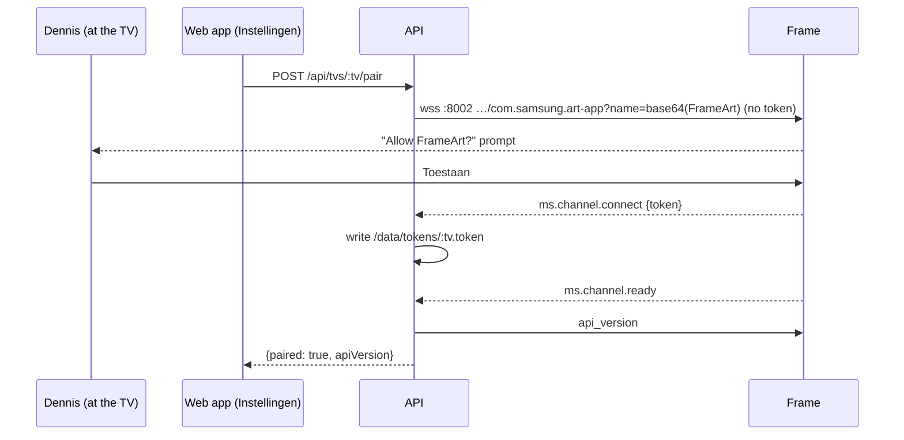

# Processes

## One tap: "Zet op woonkamer"

- Jobs for one TV run strictly one after another; the TV dislikes parallel art connections (`FrameTV.serial`).
- A failing cleanup never fails the job; the next job retries.
- `fill` is downgraded to `light` when the work's aspect is outside 1.5–2.1.

## Pairing

- Weigeren → `ms.channel.unauthorized` → a clear error in the UI. No answer within 60 s → timeout.
- Without a token file the add-on never opens the art channel (`FrameTV.withClient` refuses), so no stray prompts appear.

## Catalogue sync

- Runs at start when the catalogue is empty (or with `sync_on_start`), then every night at `sync_hour`.
- Harvesters, in order: Cleveland (paged, cheap), the Met (`/v1.1/search` ID lists, then one object per ID), the Rijksmuseum (Linked Art search pages, then one object per ID). Each skips IDs it already knows.
- One museum failing never stops the others; the error shows under Instellingen.
- Between syncs, `enrichColors` downloads thumbnails slowly (1 per second) for the dominant colour and a missing aspect.

## Rotation (HA / Node-RED)

`button.frame_art_<tv>_nieuw` → MQTT `frame_art/<tv>/new/set` → `pickNext`: a random work from the TV's rotation category (`select.frame_art_<tv>_rotatie`), landscape-friendly, not among the last 60 shown on that TV → a normal job in `default_mode`.

## Release

1. Bump `version` in `frame_art/config.yaml` and add a `CHANGELOG.md` entry.
2. `chore(release): x.y.z`, push to `main`: CI runs the checks and publishes `ghcr.io/dstollie/frame-art-aarch64:x.y.z` (and `latest`) the first time that version is seen.
3. Optionally tag `vx.y.z`; CI checks that the tag matches `config.yaml`.
4. The Supervisor shows the update; installing pulls the image.
