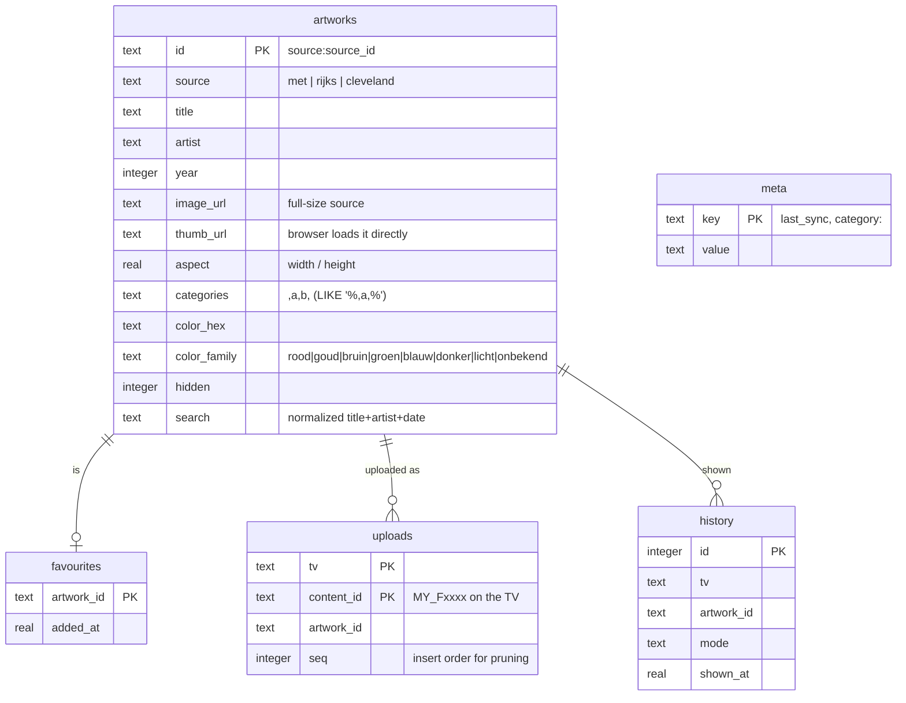

# Data models

SQLite at `/data/frame_art.sqlite`, defined with drizzle in `packages/server/src/db.ts`. Tables are created at boot (`CREATE TABLE IF NOT EXISTS`); there are no migrations yet. When a column changes, add an idempotent `ALTER TABLE` next to the DDL.

## Rules

- **Upsert never wipes knowledge:** `aspect` and `max_px` use `COALESCE(excluded, existing)`.
- **"Liggend" means 1.2 ≤ aspect ≤ 2.8.** Wider (handscrolls) and narrower (portrait) works stay browsable with the switch off.
- **Ordering** of the browse grid is a per-day seeded shuffle (`rowid * seed % 1000003`), so paging is stable within a day and the gallery feels fresh tomorrow.
- **Pruning** uses `seq`, not timestamps: several uploads within one second must still keep their order.
